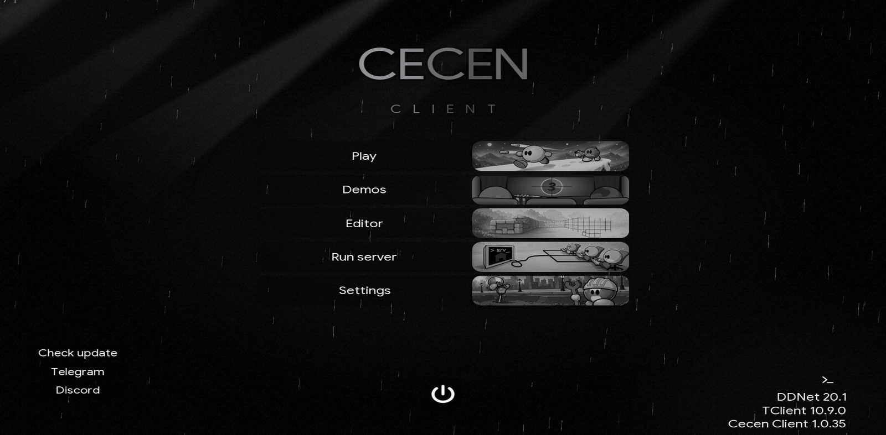
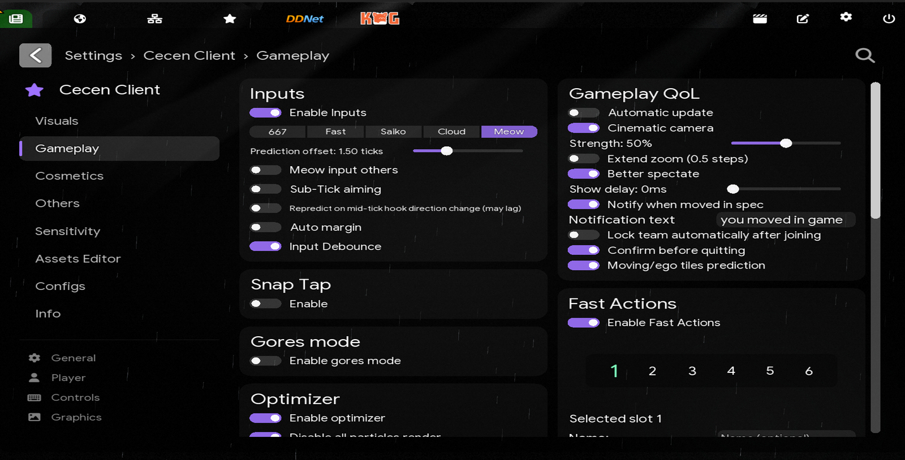
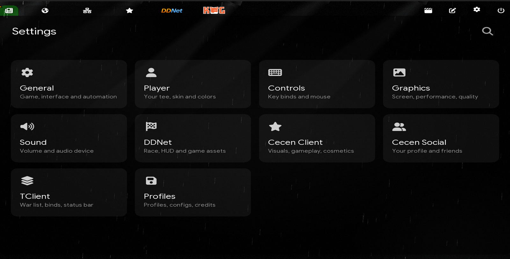

  <h1>Cecen Client for most Tryhard DDNet players</h1>
  
DDNet client focused on performance, comfort and competitive quality-of-life features. macOS first, Windows and Linux supported.

  

    <a href="https://www.revo667.com">Website</a> ·
    <a href="https://discord.gg/667">Discord</a> ·
    <a href="https://github.com/revo667/cecen-client-releases/releases/latest">Download</a>
  

  
<b>Using any part of the Cecen Client code requires permission from the project owner.</b> 
  Ask on <a href="https://discord.gg/667">discord.gg/667</a> or write to <a href="mailto:contact@revo667.com">contact@revo667.com</a>.

  

## Features

### Gameplay

- **Inputs** — 667, Fast, Saiko, Cloud and Meow input prediction, Auto Margin, Input Debounce
- **Snap Tap** — instant opposite left/right switching
- **Optimizer** — disable particles/quads, FPS fog
- **Gores mode** — entity-like mode with auto-disable while holding weapons
- **Fast Actions** — quick command selector
- **Finish Prediction** — finish progress prediction on race maps
- **Focus Mode** — hide distracting HUD/UI elements
- **Fast Practice** — local practice world with practice chat commands

### Cecen UI

- **Settings hub** — every setting grouped into categories, with search
- **HUD Editor** — drag, drop and resize HUD modules
- **Better UI** — themed checkboxes, scrollbars, tabs, color pickers and per-element colors
- **Assets Editor**, **Admin Panel**, **Translate**
- **Server browser** — live map preview, auto refresh, short EGO/KoG names
- **Mini games** — Casino, Snake, Minesweeper, Chess, Memory, Pong, Brick Breaker, Sudoku

### Cecen Social

- **Profiles** — picture, bio, connections and badges, shown on the scoreboard card
- **Friends** — who is online, where they play and what they listen to
- **Spotify Listen Along** — listen to the same song as a friend, kept in sync through Spotify Connect
- **Discord Rich Presence**

### Visuals

- **Chat Media** — inline photo/GIF previews with a domain filter
- **Hook effects** — air jump ring, hammer slash, hook lasso and hook hold energy
- **Weapon glow** — laser, shotgun and grenade glow
- **3D Particles** — cubes/hearts/mixed, glow, player push
- **Weather** — snow, rain, fireflies and ambient dust
- **Media Background** — video/image in menus and in game
- **Animations** — UI reveal, chat, killfeed and main menu animations
- **Music Player** — HUD player with visualizer and synced lyrics
- **Keystrokes** — Classic / Minecraft keyboard and mouse HUD
- **Custom Aspect Ratio** — presets and arbitrary ratios
- **Chat Bubbles** — bubbles above players

Demo playback only: **Camera Drift**, **Dynamic FOV**.

## Source

Parts of Cecen Client (Cecen UI, Cecen Social, Spotify Listen Along, Meow input and the services behind them) are closed source and live in a private repository, so this repository alone does not build the full client. Download the client from the [releases](https://github.com/revo667/cecen-client-releases/releases/latest).

## Credits

Cecen Client is a fork of [BestClient](https://github.com/BestProjectTeam/BestClient), which builds on [TClient](https://github.com/sjrc6/TaterClient-ddnet) and [DDNet](https://github.com/ddnet/ddnet).

Some features were adapted from [Entity-Client](https://github.com/FoxNet-DDNet/Entity-Client-DDNet) (Better Spectate, Chat Bubbles) and [RushieClient](https://github.com/RushieClient/RushieClient-ddnet) (Chat Filter, Find Teleport, Find Finish).

## License

Cecen Client's own code is © 2026 667.wtf, all rights reserved: it may not be used, copied, modified or redistributed without written permission from the project owner ([discord.gg/667](https://discord.gg/667), [contact@revo667.com](mailto:contact@revo667.com)). See [LICENSE](LICENSE).

Code inherited from BestClient stays under the MIT License (Copyright (c) 2026 BestProject), included in [LICENSE](LICENSE). Upstream DDNet/Teeworlds/TClient code, third-party libraries and assets under `data/` remain under their original licenses — see [license.txt](license.txt) and the per-directory `license.txt` files.
